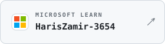

<!-- Header -->

  

  
  
  
  

## 🧠 About Me

👋 Hi, I'm **Haris Zamir**, a CS Junior at **NED University of Engineering and Technology**.
With a keen interest in technology, programming, and innovation, I’m currently exploring the vast field of cybersecurity while also dabbling in web development and building personal projects to sharpen my skills :D

---

## 💻 Tech Stack

<table align="center">
<tr>
<th align="left">💻 Programming Languages</th>
<td>

</td>
</tr>

<tr>
<th align="left">🌐 Web Development</th>
<td>

</td>
</tr>

<tr>
<th align="left">🛡️ Cybersecurity</th>
<td>

</td>
</tr>

<tr>
<th align="left">🛠️ Developer Tools</th>
<td>

</td>
</tr>
</table>

---

## 🎖️ Credly Badges

<!-- START_CREDLY_BADGES -->

<!-- END_CREDLY_BADGES -->

---
